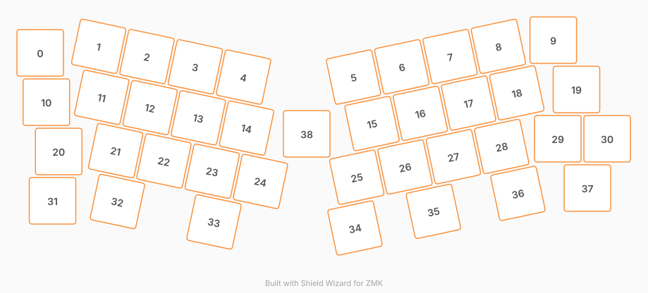

# ZMK Configuration for brisure

*Generated by Shield Wizard for ZMK*



Download compiled firmware from the Actions tab. <https://zmk.dev/docs/user-setup#installing-the-firmware>

Edit your keymap <https://zmk.dev/docs/keymaps>.
User keymap is located at [`config/brisure.keymap`](config/brisure.keymap).

-----

<details>
<summary>
Shield Wizard Debug Information
</summary>

In case of broken configuration, here is the Shield Wizard internal data used to generate this configuration:

Commit: 84a348b08cf4fec4a5441a46147e9a345b10ffab

```json
{"name":"brisure","shield":"brisure","dongle":false,"modules":[],"layout":[{"id":"01M4P0Y7YT6623P2H2R50PKRQ9","part":0,"row":0,"col":0,"w":1,"h":1,"x":0,"y":0.258,"r":0,"rx":0,"ry":0},{"id":"01M4P0Y7YTVP62TJ0QW4M9TF3D","part":0,"row":0,"col":1,"w":1,"h":1,"x":1.186,"y":0.125,"r":12,"rx":1.686,"ry":0.625},{"id":"01M4P0Y7YVJ708GZFAABK31YTA","part":0,"row":0,"col":2,"w":1,"h":1,"x":2.164,"y":0.333,"r":12,"rx":2.664,"ry":0.833},{"id":"01M4P0Y7YV7WK6GPZKTKDT3QDN","part":0,"row":0,"col":3,"w":1,"h":1,"x":3.143,"y":0.541,"r":12,"rx":3.643,"ry":1.041},{"id":"01M4P0Y7YVK218KVQ6XJ6ZQT7D","part":0,"row":0,"col":4,"w":1,"h":1,"x":4.121,"y":0.749,"r":12,"rx":4.621,"ry":1.249},{"id":"01M4P0Y7YVBFH9639YHG4M1WAP","part":0,"row":0,"col":5,"w":1,"h":1,"x":6.348,"y":0.749,"r":-12,"rx":6.848,"ry":1.249},{"id":"01M4P0Y7YVB2CWA2FTJ1AZ0T13","part":0,"row":0,"col":6,"w":1,"h":1,"x":7.327,"y":0.541,"r":-12,"rx":7.827,"ry":1.041},{"id":"01M4P0Y7YVHN5SNB1449RC092A","part":0,"row":0,"col":7,"w":1,"h":1,"x":8.305,"y":0.333,"r":-12,"rx":8.805,"ry":0.833},{"id":"01M4P0Y7YV0YAYYEPXBESPZF98","part":0,"row":0,"col":8,"w":1,"h":1,"x":9.283,"y":0.126,"r":-12,"rx":9.783,"ry":0.626},{"id":"01M4P0Y7YV7A016GAZK42CSSXA","part":0,"row":0,"col":9,"w":1,"h":1,"x":10.395,"y":0,"r":0,"rx":0,"ry":0},{"id":"01M4P0Y7YV217T1MRETRMTYWX3","part":0,"row":1,"col":0,"w":1,"h":1,"x":0.125,"y":1.258,"r":0,"rx":0,"ry":0},{"id":"01M4P0Y7YVY357GED6TVE374GD","part":0,"row":1,"col":1,"w":1,"h":1,"x":1.247,"y":1.16,"r":12,"rx":1.747,"ry":1.66},{"id":"01M4P0Y7YVGJM3R3BXX84X3M0M","part":0,"row":1,"col":2,"w":1,"h":1,"x":2.226,"y":1.368,"r":12,"rx":2.726,"ry":1.868},{"id":"01M4P0Y7YVYPV9M29003NZNSDX","part":0,"row":1,"col":3,"w":1,"h":1,"x":3.204,"y":1.576,"r":12,"rx":3.704,"ry":2.076},{"id":"01M4P0Y7YV23EEJ621WA9W8G7T","part":0,"row":1,"col":4,"w":1,"h":1,"x":4.182,"y":1.784,"r":12,"rx":4.682,"ry":2.284},{"id":"01M4P0Y7YVE16DCFEQ199RCP94","part":0,"row":1,"col":5,"w":1,"h":1,"x":6.723,"y":1.692,"r":-12,"rx":7.223,"ry":2.192},{"id":"01M4P0Y7YV9PH7M0H7NR6KAN0R","part":0,"row":1,"col":6,"w":1,"h":1,"x":7.701,"y":1.484,"r":-12,"rx":8.201,"ry":1.984},{"id":"01M4P0Y7YVW62RR9705N75GTNR","part":0,"row":1,"col":7,"w":1,"h":1,"x":8.679,"y":1.276,"r":-12,"rx":9.179,"ry":1.776},{"id":"01M4P0Y7YVHRH64WEG0R0V9XM2","part":0,"row":1,"col":8,"w":1,"h":1,"x":9.657,"y":1.068,"r":-12,"rx":10.157,"ry":1.568},{"id":"01M4P0Y7YW3KG3Z5902GTG3QY7","part":0,"row":1,"col":9,"w":1,"h":1,"x":10.865,"y":1,"r":0,"rx":0,"ry":0},{"id":"01M4P0Y7YV99J4J2H50AWXFJKQ","part":0,"row":2,"col":0,"w":1,"h":1,"x":0.375,"y":2.258,"r":0,"rx":0,"ry":0},{"id":"01M4P0Y7YVPVDV4WFXZ7T3B81Y","part":0,"row":2,"col":1,"w":1,"h":1,"x":1.529,"y":2.242,"r":12,"rx":2.029,"ry":2.742},{"id":"01M4P0Y7YV23NXHJB8RSXZ7B09","part":0,"row":2,"col":2,"w":1,"h":1,"x":2.507,"y":2.45,"r":12,"rx":3.007,"ry":2.95},{"id":"01M4P0Y7YVMEC4FBJGADXSE53P","part":0,"row":2,"col":3,"w":1,"h":1,"x":3.485,"y":2.658,"r":12,"rx":3.985,"ry":3.158},{"id":"01M4P0Y7YV0FZCXXNWW02REYRG","part":0,"row":2,"col":4,"w":1,"h":1,"x":4.463,"y":2.866,"r":12,"rx":4.963,"ry":3.366},{"id":"01M4P0Y7YW7R90PB2N72QQEKPH","part":0,"row":2,"col":5,"w":1,"h":1,"x":6.414,"y":2.78,"r":-12,"rx":6.914,"ry":3.28},{"id":"01M4P0Y7YW5M3CVYYYCW9EYPRN","part":0,"row":2,"col":6,"w":1,"h":1,"x":7.392,"y":2.572,"r":-12,"rx":7.892,"ry":3.072},{"id":"01M4P0Y7YW6HYCCEXNYX99JAQ4","part":0,"row":2,"col":7,"w":1,"h":1,"x":8.371,"y":2.364,"r":-12,"rx":8.871,"ry":2.864},{"id":"01M4P0Y7YWBRS0R393TPA092JD","part":0,"row":2,"col":8,"w":1,"h":1,"x":9.349,"y":2.156,"r":-12,"rx":9.849,"ry":2.656},{"id":"01M4P0Y7YWNPFTMW4BSRWPS8VS","part":0,"row":2,"col":9,"w":1,"h":1,"x":10.487,"y":2,"r":0,"rx":0,"ry":0},{"id":"01M4P0Y7YWVQPSYZX9QM29D9E9","part":0,"row":2,"col":10,"w":1,"h":1,"x":11.487,"y":2,"r":0,"rx":0,"ry":0},{"id":"01M4P0Y7YVEW460EEZZW06SQED","part":0,"row":3,"col":0,"w":1,"h":1,"x":0.25,"y":3.258,"r":0,"rx":0,"ry":0},{"id":"01M4P0Y7YVJNR6483NKQFJVCK4","part":0,"row":3,"col":1,"w":1,"h":1,"x":1.565,"y":3.273,"r":12,"rx":2.065,"ry":3.773},{"id":"01M4P0Y7YVFX355JEM12YRWX1Z","part":0,"row":3,"col":3,"w":1,"h":1,"x":3.521,"y":3.688,"r":12,"rx":4.021,"ry":4.188},{"id":"01M4P0Y7YW25RASGK358NH00GV","part":0,"row":3,"col":5,"w":1,"h":1,"x":6.378,"y":3.81,"r":-12,"rx":6.878,"ry":4.31},{"id":"01M4P0Y7YW7ZHVYAHFJCH0Q0M9","part":0,"row":3,"col":6,"w":1,"h":1,"x":7.967,"y":3.472,"r":-12,"rx":8.467,"ry":3.972},{"id":"01M4P0Y7YW8W541ZVE3WCYF0ZP","part":0,"row":3,"col":8,"w":1,"h":1,"x":9.679,"y":3.108,"r":-12,"rx":10.179,"ry":3.608},{"id":"01M4P0Y7YWRJNSHN9JQ6FQ3ZY3","part":0,"row":3,"col":9,"w":1,"h":1,"x":11.087,"y":3,"r":0,"rx":0,"ry":0},{"id":"01M4PEQXFN56RG9ENMP7AVQ689","part":0,"row":1,"col":11,"w":1,"h":1,"x":5.4,"y":1.9,"r":0,"rx":0,"ry":0}],"parts":[{"name":"unibody","controller":"nice_nano_v2","pins":{"d1":{"usage":"kscan","kscan":"01M4P0YQ4G3W0PMM8GW13KHDNG","role":"input"},"d0":{"usage":"kscan","kscan":"01M4P0YQ4G3W0PMM8GW13KHDNG","role":"input"},"d2":{"usage":"kscan","kscan":"01M4P0YQ4G3W0PMM8GW13KHDNG","role":"input"},"d3":{"usage":"kscan","kscan":"01M4P0YQ4G3W0PMM8GW13KHDNG","role":"input"},"d4":{"usage":"kscan","kscan":"01M4P0YQ4G3W0PMM8GW13KHDNG","role":"output"},"d5":{"usage":"kscan","kscan":"01M4P0YQ4G3W0PMM8GW13KHDNG","role":"output"},"d6":{"usage":"kscan","kscan":"01M4P0YQ4G3W0PMM8GW13KHDNG","role":"output"},"d7":{"usage":"kscan","kscan":"01M4P0YQ4G3W0PMM8GW13KHDNG","role":"output"},"d8":{"usage":"kscan","kscan":"01M4P0YQ4G3W0PMM8GW13KHDNG","role":"output"},"d9":{"usage":"kscan","kscan":"01M4P0YQ4G3W0PMM8GW13KHDNG","role":"output"},"d10":{"usage":"kscan","kscan":"01M4P0YQ4G3W0PMM8GW13KHDNG","role":"output"},"d16":{"usage":"kscan","kscan":"01M4P0YQ4G3W0PMM8GW13KHDNG","role":"output"},"d14":{"usage":"kscan","kscan":"01M4P0YQ4G3W0PMM8GW13KHDNG","role":"output"},"d15":{"usage":"kscan","kscan":"01M4P0YQ4G3W0PMM8GW13KHDNG","role":"output"},"d18":{"usage":"kscan","kscan":"01M4P0YQ4G3W0PMM8GW13KHDNG","role":"output"},"d19":{"usage":"encoder","encoderId":"01M4P15AGP9H9GMCW8JJ3VCH66","role":"pinA"},"d20":{"usage":"encoder","encoderId":"01M4P15AGP9H9GMCW8JJ3VCH66","role":"pinB"},"d21":{"usage":"bus","bus":"i2c0","role":"sda"},"p101":{"usage":"bus","bus":"i2c0","role":"scl"},"p102":{"usage":"kscan","kscan":"01M4PE8XR744JXWYQBJSTD5CBR","role":"input"},"p107":{"usage":"kscan","kscan":"01M4PE8XR744JXWYQBJSTD5CBR","role":"output"}},"kscans":[{"kind":"matrix","id":"01M4P0YQ4G3W0PMM8GW13KHDNG","diodes":true},{"kind":"matrix","id":"01M4PE8XR744JXWYQBJSTD5CBR","diodes":false}],"keys":{"01M4P0Y7YT6623P2H2R50PKRQ9":{"input":"d1","output":"d4"},"01M4P0Y7YTVP62TJ0QW4M9TF3D":{"input":"d1","output":"d5"},"01M4P0Y7YVJ708GZFAABK31YTA":{"input":"d1","output":"d6"},"01M4P0Y7YV7WK6GPZKTKDT3QDN":{"input":"d1","output":"d7"},"01M4P0Y7YVK218KVQ6XJ6ZQT7D":{"input":"d1","output":"d8"},"01M4P0Y7YVBFH9639YHG4M1WAP":{"input":"d1","output":"d9"},"01M4P0Y7YVB2CWA2FTJ1AZ0T13":{"input":"d1","output":"d10"},"01M4P0Y7YVHN5SNB1449RC092A":{"input":"d1","output":"d16"},"01M4P0Y7YV0YAYYEPXBESPZF98":{"input":"d1","output":"d14"},"01M4P0Y7YV7A016GAZK42CSSXA":{"input":"d1","output":"d18"},"01M4P0Y7YV217T1MRETRMTYWX3":{"input":"d0","output":"d4"},"01M4P0Y7YVY357GED6TVE374GD":{"input":"d0","output":"d5"},"01M4P0Y7YVGJM3R3BXX84X3M0M":{"input":"d0","output":"d6"},"01M4P0Y7YVYPV9M29003NZNSDX":{"input":"d0","output":"d7"},"01M4P0Y7YV23EEJ621WA9W8G7T":{"input":"d0","output":"d8"},"01M4P0Y7YVE16DCFEQ199RCP94":{"input":"d0","output":"d9"},"01M4P0Y7YV9PH7M0H7NR6KAN0R":{"input":"d0","output":"d10"},"01M4P0Y7YVW62RR9705N75GTNR":{"input":"d0","output":"d16"},"01M4P0Y7YVHRH64WEG0R0V9XM2":{"input":"d0","output":"d14"},"01M4P0Y7YW3KG3Z5902GTG3QY7":{"input":"d0","output":"d18"},"01M4P0Y7YV99J4J2H50AWXFJKQ":{"input":"d2","output":"d4"},"01M4P0Y7YVPVDV4WFXZ7T3B81Y":{"input":"d2","output":"d5"},"01M4P0Y7YV23NXHJB8RSXZ7B09":{"input":"d2","output":"d6"},"01M4P0Y7YVMEC4FBJGADXSE53P":{"input":"d2","output":"d7"},"01M4P0Y7YV0FZCXXNWW02REYRG":{"input":"d2","output":"d8"},"01M4P0Y7YW7R90PB2N72QQEKPH":{"input":"d2","output":"d9"},"01M4P0Y7YW5M3CVYYYCW9EYPRN":{"input":"d2","output":"d10"},"01M4P0Y7YW6HYCCEXNYX99JAQ4":{"input":"d2","output":"d16"},"01M4P0Y7YWBRS0R393TPA092JD":{"input":"d2","output":"d14"},"01M4P0Y7YWNPFTMW4BSRWPS8VS":{"input":"d2","output":"d15"},"01M4P0Y7YWVQPSYZX9QM29D9E9":{"input":"d2","output":"d18"},"01M4P0Y7YVEW460EEZZW06SQED":{"input":"d3","output":"d4"},"01M4P0Y7YVJNR6483NKQFJVCK4":{"input":"d3","output":"d5"},"01M4P0Y7YVFX355JEM12YRWX1Z":{"input":"d3","output":"d7"},"01M4P0Y7YW25RASGK358NH00GV":{"input":"d3","output":"d9"},"01M4P0Y7YW7ZHVYAHFJCH0Q0M9":{"input":"d3","output":"d10"},"01M4P0Y7YW8W541ZVE3WCYF0ZP":{"input":"d3","output":"d14"},"01M4P0Y7YWRJNSHN9JQ6FQ3ZY3":{"input":"d3","output":"d18"},"01M4PEQXFN56RG9ENMP7AVQ689":{"input":"p102","output":"p107"}},"encoders":[{"id":"01M4P15AGP9H9GMCW8JJ3VCH66"}],"buses":{"i2c0":{"type":"i2c","devices":[{"id":"01M4P1EP4J36D1CX4BXQFKY3RM","type":"ssd1306","add":60,"width":128,"height":64}]}}}]}
```

</details>
